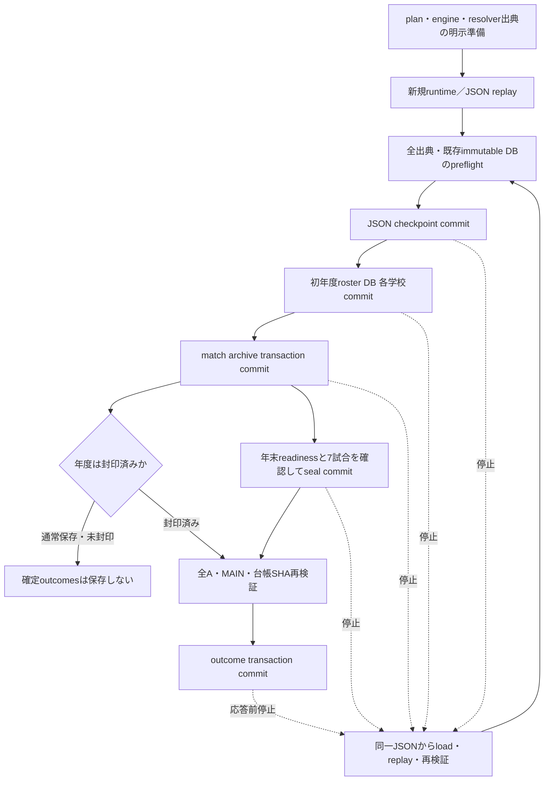

# Stage43G-100 初年度ロスター・大会結果の製品保存設計

Windows専用・個人利用・非配布。開始点はPR #254マージ後の最新main `4ee0f91`、Issue #255。既存の8校2026年単大会を対象とし、Stage99の明示closeとバックアップ内容／replay承認の分離を維持する。初年度の実生成選手IDは選手名と独立したキーである。実在選手の名簿を取り込んだという意味ではなく、既存generatorによる選手と実試合の出典を保存する。

## 出典と所有者

|時点／経路|変更前の出典・限界|Stage100の責務・検証|
|---|---|---|
|new_game初期、試合0件|resolverのcacheは空。学校が実際に試合へ登場するまで全ロスターを証明できない|明示契約を有効にした場合だけ、runtime構築前にbuilt-in generatorで全8校を固定seed生成。resolverが正本入力を保持し、初回manualから保存する|
|試合入力|`team_input`が学校・年度・effective team seedで生成／cache。cacheは性能用で、初年度全校・出典の証明ではない|確定済み初年度入力からteam_inputへ渡す。cacheをclearしても入力は保持。正本の欠落、cacheと能力入力の食い違いは拒否|
|load_game、JSON replay|plannerを再構築し既存save結果と決定論的replayを照合。その後archiveへsyncを書き得る|replay前に同じ明示入力を準備。契約名、plan fingerprint、年度、seed、engine/resolver identityを照合。replay後の実runtimeから全Aと選手所属を検証し同期|
|manual／autosave|JSON→match archive。独立ファイル間で原子的ではない|全出典・既存DBをpreflight→JSON→初年度ロスター→match archive。初回挿入／同一再保存は冪等。部分commitは同一checkpointから再試行|
|finalize_season|年末readiness→manual→試合件数を検証して封印。workerが後付けでroster／outcomesを書いていた|同じ保存導線→年度封印→MAIN結果・全7試合・台帳SHAを検証→既存`record_completed`。暫定順位からoutcomesは作らない|
|封印済ロード／2回再保存|workerの後付け保存は本体サービスの責務外|完全な7試合checkpointのみ受理。同一ロスター・結果の再保存。seal後outcome commit前の停止もloadから再試行し、既存確定結果は上書きしない|
|年次roster advance|保存済前年ロスターから`advance_school_roster`が学年更新／卒業／新入生を生成|契約外。初年度入力を翌年へ流用せず、異年度は拒否。既存年次サービスは変更しない|
|県／地区feeder、qualifier|封印済結果、別途登録されたロスターを用いる明示bridge群。県ごとのpre-MAIN出典・資格条件が異なる|今回のMAIN単大会と同一視しない。既存経路はopt-outのまま。自動資格接続・翌年全大会生成は実装しない|
|過去記録閲覧|Stage99で製品read／generatorのcloseを改善。Stage98デモには限定的cleanupも残る|既存学校／試合／個人画面を維持。デモに小さい確定順位表示を追加し、専用native read-only接続でseal・payload・元試合manifest SHAを確認|

## 明示的な狭い契約

`InitialCareerPersistence`を`LiveGameService(career_persistence=...)`へ明示指定する。指定なしのdefault／他ゲームモードの呼出し、保存schema、writerは維持する。対応範囲は2026年、CMP000029、SCH001862〜SCH001869の8校、MAIN7試合、明示的AbilityMatchResolverとTournamentEngineの組合せ。専用resolver契約`initial_ability_career_v1`で旧デモ／旧saveをロード対象へ昇格しない。

契約は承認されたplan fingerprintとresolverを保持する。runtime/replay構築前に`prepare_initial_rosters`が正本入力を生成する。既に試合cacheを作ったresolverを後付けで正本化しない。外部roster_provider、独自generator、default／別resolver、別plan／年度／seed／学校集合、未対応試合構造は拒否する。公開snapshotはdetached copyで、欠落時に再生成して埋めない。生成recipe・所属・学年・player_idを再確認し、実入力cacheの能力も正本から作った値と比較する。将来の全国拡張はこの責務境界を利用できるが、単に許可集合を拡大するだけでは承認しない。

全校のロスターは初年度生成seed・年度・school_id・program_id・学年・入学年・選手IDを持つ。roster正本と既存immutable snapshot、永久identityのpayload／digestを比較する。同名異IDを名前で結び直さない。各学校snapshot＋identity挿入は既存DB transactionでrollbackし、確定済み過去の選手履歴は変更しない。8校全体は複数commitで、部分保存された同一入力だけは再試行可能である。

完全Option Aはscore_source／年度／大会／試合／対戦校／team generation seedを確認し、既存archiveのscore・inning・team検証と個人stat validator、項目集合、両校の所属・選手ID、個人合計とteam値を確認する。MAIN結果とruntime score／winner／loserも一致させる。`record_completed`を呼ぶ前に全7試合の保存一致、封印台帳の件数／SHAを確認し、既存outcome writerの不一致拒否を維持する。

## 保存順序と失敗時

JSON、roster DB、match/outcome DB、slot metadataは一つのtransactionではない。JSONのcommit直後／3校commit後／archive commit前／seal commit後／outcome commit後の応答前停止を注入して、自己生成fixtureの再ロードで整合に復帰できることを試験する。全正本が常に原子的に更新されるとは保証しない。save失敗時は正常完了を返さず、既存封印結果の削除・解除・書換えを行わない。

既存DBと出典が異なる場合、古い6試合saveから新しい7試合履歴へ戻そうとする場合、封印台帳／選手identityが破損した場合は安全な診断で拒否する。外部ファイルの任意欠損を自動修復する一般機構ではない。別writerとの並行更新、OS／電源断でのファイル破壊、候補生成時真正性、他モード／他年度の再試行可能性は保証しない。JSON以前の未checkpoint試合も救済できない。

## 互換入力catalogと変更前後の実候補

製品ソース変更前に、Git履歴のStage94固定版とPR #254マージmain（Stage99固定版）を私的一時checkoutへ展開し、各版の実コードを別Pythonプロセスで使って自己生成停止済み旧A候補をexport・verifyした。候補内コードは実行しない。候補の版名・receipt・payloadを更新しない。

338ファイルの集合は維持し、catalog内で変更するのは`live_game_service.py`と`tournament_bridge.py`の2件。新固定IDを`stage43g100-initial-career-persistence-v1`とし、旧Stage94／Stage99のknown aggregate digestを保持する。残り336入力とmaster106CSVを含むdata全bytes不変を独立比較する。個別private SHA／pathはPR／公開artifactへ出さない。

|候補|内容verify|現行replay|
|---|---|---|
|変更前Stage94実候補|版固有digestでread-only受理|版差不一致・自動承認なし|
|変更前Stage99実候補|版固有digestでread-only受理|版差不一致・自動承認なし|
|Stage100自己生成候補|導入済338と一致する内容を受理|別replayレビューが必要・許可false|
|旧候補の版名だけ差替え／欠損／改ざん／診断中変更|拒否|許可なし|

旧Stage99の寿命回帰は原来の5ファイル変更に今回の2依存変更を明示して維持する。旧候補を生成するGit checkoutは試験用一時領域だけで、製品への旧338常設同梱はしない。候補内容verifyとゲーム本体の限定的な自己生成save loadは別の契約である。

## Windows受入と残るデモ境界

専用Python3.12 CIで14件の製品／2旧版候補回帰と1件のnative mapped Tk E2Eをzero skipsでgateする。Tkは両sourceごとに新規→6試合→autosave/manual→GUI終了→別workerプロセスload→7試合→封印→学校／個人成績／確定順位→read-only byte不変→終了後renameを確認する。保持したconnection／例外frameをfixtureがcloseする前に製品closeをassertし、Windows rename／再読取を試験する。Stage94–99 CI、全unittest、関東8都県17校専用E2Eも維持する。

Stage98 controllerの自己生成領域・staging generation・非同期worker、固定8校planner、`demo_read_handles`は引き続きデモ限定。製品の保存契約はserviceだけのheadless試験で確認する。学校／選手画面の既存cleanupによる成功を全面的SQLite寿命保証としない。順位readerはcleanup scopeの外で自身の接続をcloseする。人のWindows個人PC目視・操作は未検証。

本番restore/import/activation、既存saveの移行・上書き・試験利用、履歴削除、schema migration、全国複数大会の全年度運転、pre-MAIN feederの本体接続、翌年資格自動接続、正式全国GUI／配布EXEは実施しない。全CI成功後も未マージ・auto-mergeなしでレビュー待ちにする。
