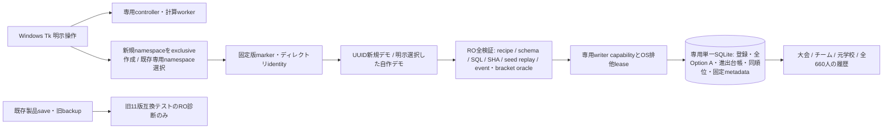

# Stage43G-109 Windows山梨夏デモ 操作・保存設計

実装前設計。対象はゲーム内試験用2026年山梨県夏季大会（架空選手・架空組合せ・架空結果）。Windows Python 3.12/Tk、個人利用・非配布。Stage108の33校660永久ID、公式表示名対応32チーム640登録、合同の元学校ID、5ラウンド31試合の完全Option Aをそのまま使用する。

## 契約の分離

|領域|所有・開始|再開|書込み・原子性|
|---|---|---|---|
|Stage108 lab|生存中の親TemporaryDirectoryと実体capability|親の所有期間内のみ|既存OwnedTournamentStoreを変更しない|
|Stage109専用namespace|ユーザーが未存在の保存ルートを明示作成。専用版markerをexclusive作成|ルートmarker・実体identityを検証。専用直下の自作demo IDだけを明示選択|新しいDemoStore。任意SQLiteパスを受け取らない|
|Stage109各デモ|UUID子ディレクトリ・DB・固定markerをexclusive作成|markerとDB内metadata、schema、固定recipe、全既存試合をRO照合した後にのみ継続|単一SQLiteの1試合transaction。JSONチェックポイントは置かない|
|製品SaveSlotManager / LiveGameService|manual/autosave・既存複数DBの製品契約|今回接続しない|製品writer/schema・ローテーションを変更しない|
|Stage94旧バックアップ|停止時の手動export・338互換catalog|readonly診断・内容verifyのみ。実ユーザー候補は使用しない|restore/import/activation・移行・上書き・削除を追加しない|

## 操作とWindows起動

リポジトリで `py -3.12 -m phase2_engine.yamanashi_demo_tk`。初回は「専用保存先を新規作成」で未存在フォルダー名を選ぶ（既存フォルダーを採用しない）。次回は「専用保存先を開く」でこの機能が作成したルートを選び、一覧のデモを選択して「続きから」。保存先選択はこのnamespaceのためだけで、製品slotやbackupは列挙しない。

「新規32チームデモ」→登録・学校・全660人と未登録20人の閲覧→「次の1試合」または「このラウンドの残り」→各試合commit後に自動保存件数・次の対戦・全inningと実出場投打成績を表示→「終了」→Pythonプロセス完全終了→再起動→同じ専用namespace/デモを明示選択→全prefix検証→続行。新規ボタンは常に別IDを作り、同名で初期化しない。5ラウンド後は同1/2/3/5/9/17位と履歴を表示する。

Tk操作と計算を分離し、workerからwidgetを触らず、メインイベントループがqueueをpollする。処理中は表示を消去して二重操作を防ぎ、終了要求は計算のcancelを通知する。commit前の未保存結果は破棄し、実行中transactionの終了を待ってから画面と接続を閉じる。commit済みのみが再開対象。ラウンド全体は原子的ではない。

## 作成・再開の拒否条件

保存ルートは新規専用namespaceに限定。Git/data・製品save/backup領域との重なり、親経由の`..`、symlink/junction/reparse、hardlink、未知ファイル・版、実体差替を拒否する。固定markerにはnamespace/demo ID、実体identity、year/competition/seed、登録・plan・schema SHAを記録し、DB内にも同じ固定metadataを置く。markerは試合ごとに書き換えない。SHAと実体identityは整合性検査であり、第三者真正性署名ではない。コピーしたDB/markerや任意SQLiteを所有領域へ採用しない。

再開ではSQLite接続前のDELETE形式header検査・RO mode・query_only・全schema/全行比較・verify_prefix・独立event oracle・同seed全再実行・bracket oracle・raw SQL/SHAを通す。RO検査前後のDB bytesを照合し、検証不能は修復しない。journal/WAL等のsidecar、DBロック、未知schema、違うseed/出典、欠損・破損は拒否。プロセス排他はOSが終了時に解放する固定leaseファイルで、stale lock削除や自動recoveryはしない。各操作時も実体を再確認する。Windowsでは開いている実体の置換を防ぐnative handleも保持する。

## 検証と未対象

新Stage109 gateはheadless新規→1→16→31試合の独立Pythonプロセス再開とnative mapped Tkの実ボタン操作、途中終了/未commit取消、破損拒否時の画面消去、32team選択/scroll、close後rename/reopenをskip 0で行う。旧Stage91–108 CIを維持し、全unittest・関東17校E2E・真の旧main 11版候補をreadonly内容verifyする。原本の個別SHA・絶対パスをartifactへ記録しない。

Windows runner自動操作と個人PCで人が行うマウス操作は区別する。OSセッションを跨ぐ個人PC確認は別添手順で未実施として記録する。固定2026 seed・試合間疲労/怪我・犠打/盗塁/失策等未実装は画面ヘルプに明記する。2027試合、全国進行、正式GUI、製品restore、削除/GC、EXE/installerは未対象。共有基盤に年度上限を追加しない。
