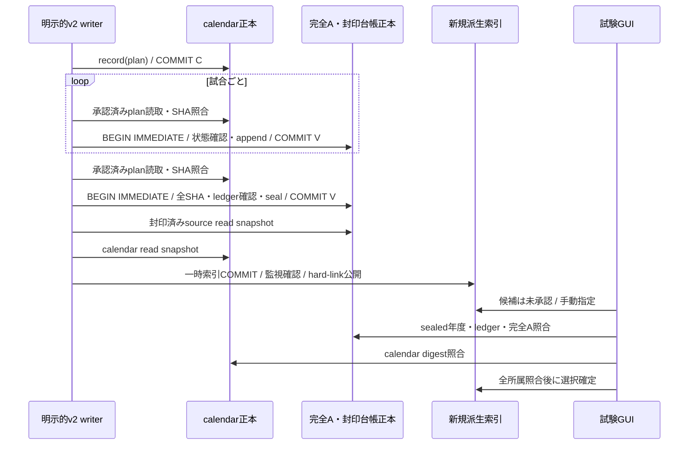
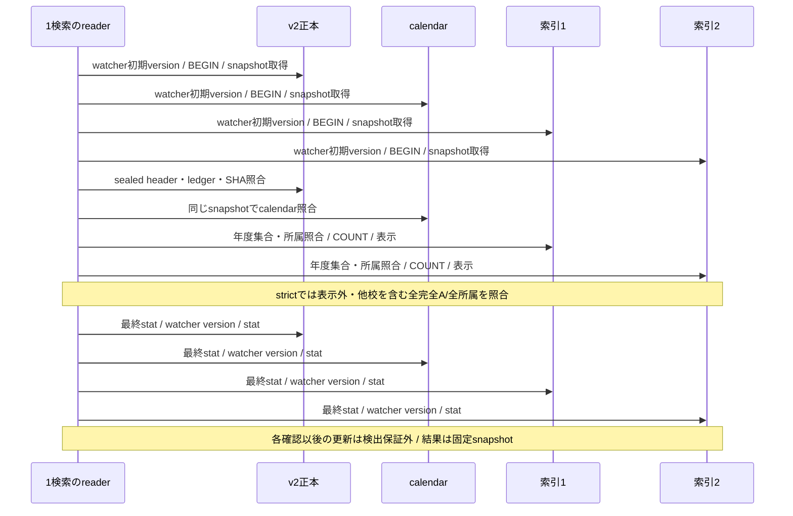

# Stage 43G-89：複数SQLite保存・読取snapshotの競合設計

2026-10-12（日本時間）。Issue #233。基点：最新main `09f80cf42d173988231992b57954027abd99e2da`（PR #232マージ）。専用ブランチ `codex/stage43g89-sqlite-snapshot-audit`。

## 正本と実際の保存経路

Stage87/88の設計・報告、全呼出し箇所と下記実装を確認した。学校索引は正本ではない。v2は明示的な架空日付のsandboxであり、実大会進行へ接続されていない。実際のlive保存は `live_season_save.py` / `historical_match_archive.py` の旧A経路で、本Stageで旧A writerの契約を変更しない。

| ファイル・実装 | 正本性・更新契約 | transactionの境界 |
|---|---|---|
| `career_calendar_v2.py` の `CareerCalendarV2Archive.record` | 各年度の明示承認済みplan正本。既存planの変更拒否 | plan検証→既存確認→INSERT→calendarのみCOMMIT。既存同一planは無挿入 |
| `career_v2_option_a_archive.py` の `append` | 完全Aの最終スコア、全イニング、チーム・打者・投手成績正本。既存試合変更・sealed年度への新規追加拒否 | calendarを別接続で検証→旧A衝突確認→v2で年度状態確認・INSERT→v2のみCOMMIT |
| 同 `seal_year` | `v2_game_years` の封印headerとledger正本。試合集合から再計算 | calendarを別接続で検証→v2内で全payload・ledger・件数確認→header UPDATE→v2のみCOMMIT |
| `career_v2_school_read_index.py` のbuild | 派生 `indexed_year` / `school_game`。source/calendarを変更しない | source/calendar読取→一時索引へINSERT/COMMIT→監視確認→hard-linkで新規path公開 |
| `career_v2_school_century_shards.py` のbuild | 100年度区間の独立索引。全シャード一括transactionはない | 全対象path衝突事前確認→区間ごとに上記build。途中失敗では先に生成した索引が残り得る |

呼出し例として `career_v2_national_storage_audit.synthetic_storage_fixture` は年度ごとにcalendar登録、各試合append、sealの順で実APIを呼ぶ。学校GUIの検索は保存や索引生成を呼ばない。索引生成・選択は独立した明示操作である。`CareerHistorySlotSession.select` は新しいbridgeを検証してから切替え、旧slotのroute・proofを転用しない。

## 原子性が必要な場面と不要な場面

| 場面 | 実コードの書込か | 必要な整合性・対応 |
|---|---|---|
| calendar登録だけ完了 | 実API | 未使用のplan追加は過去のsealed結果を変えない。v2保存年度として表示しない |
| v2年次追加中 | 実API。試合ごとcommit | active年度は学校索引検索・生成をfail-closed。sealed過年度だけの検索中でも観測したDB更新を拒否 |
| seal ledger更新 | 実API | **同じv2 DB内の試合集合とheaderに原子性が必要**。append/sealとも状態確認前にBEGIN IMMEDIATE |
| 既存索引の更新 | 通常APIではしない | 独立不変索引は上書きしない。新年度後の古い索引は年度集合不一致で拒否。新規版を明示作成・選択 |
| 索引生成中 | 実API | source/calendar各snapshotを固定しwatcherで変更拒否。新規target競合はhard-link失敗。全シャード一括成功や最新世代公開の保証はない |
| 別セーブ選択 | 実GUIモデル | 新bridge・新readerを構築。foreign pathの索引拒否。表示/選択stateは検証成功後にのみ更新 |
| 既存sealed原本/既存calendarの段階的書換え | 通常APIは拒否。raw SQL/renameによる仮想状態 | adversarial試験として区別する。checksum・ledger・年度集合・出典照合またはwatcherで拒否。永続世代atomic性は証明しない |

calendar/v2/索引の一括COMMITは現在存在しない。通常writerは既存calendarとsealed年度を不変にし、過去の整合したprojectionまたはactive/staleの拒否を許容する設計である。原本・calendar間の移行transactionや共通ロックを導入する必要は、本Stageの単一DB保存競合修正からは生じない。

## 再現した不整合保存と最小修正

修正前はSQLiteの暗黙transactionが最初のDMLで開始された。`with con:` 自体はtransactionを開始しない。

1. sealがactive状態・全payloadを読み、ledgerを1試合として計算。
2. 別接続のappendがactive状態を確認し、2試合目をINSERT/COMMIT。
3. sealが古い件数1・古いledgerをUPDATE/COMMITし成功を返す。
4. 独立SQL oracleでは原本2試合とheader1試合が不一致。以後のreaderはledger不一致で拒否する。

逆順も再現した。appendがactiveを確認して停止→sealが1試合として封印→appendが確認済みactive状態を使って2試合目をcommit。両APIが成功するが封印済み原本へ追加される。これは実APIで到達可能な保存の欠陥であり、単なる仮想raw改ざんではない。

append/sealのv2接続に **BEGIN IMMEDIATEを各1箇所追加**。状態確認、全payload/ledger確認、書込、commitを同じwriter予約付きtransaction内で行う。seal先行なら後続appendはsealedを確認して拒否、append先行なら後続sealは増えた件数を見てexpected_count不一致を拒否する。正しい件数で明示的に再seal可能。例外時はrollback、接続はclosingで解放。既存SQLite schema、ファイル形式、封印済み内容、保存API返値は変えない。SQLiteの既存busy timeoutは維持し、無期限retryや独自永続lockは追加しない。

独立索引生成にも既存 `_school_read_request` を利用する。従来の「再ledger確認」は同じ固定snapshotを再読するため外部commitを検出できなかった。新方式はcalendarもsnapshot固定し、BEGINしないwatcherでdata_version/device/inodeを確認してから公開する。既存索引の上書き拒否は維持する。

最終監視はstat→data_version→statとし、最初のstat後・watcher読取前のrenameを拒否する。修正前のその狭い窓は旧inodeのwatcherで旧snapshotを返し、byte同一差替えを検知しなかった。返値自体は独立oracleと一致しており、混合した学校試合結果の再現とは区別する。

## 読取snapshotの保証境界

保証するのは、ファイルごとに固定されたsnapshot上の出典・封印・ledger・calendar検証、pageの表示対象SHA、strictの全payload/全所属、同じsnapshotでの件数とページ、一観測区間内に検知したSQLite commit/renameの拒否である。WAL checkpointのみなら内容世代を変えず、一貫した結果を許容する。rollback journalではread lockがwriter commitを阻止し、busyならwriter側でrollbackする。

**複数ファイル全体の同一時点snapshot、全DBの同一保存世代、結果返却時の最新版は保証しない。** 各DBのsnapshot取得・最終確認は順次実行である。各fileの最終data_version観測後のcommit、全監視終了後のappend、索引公開直前/直後の更新は観測できないことがある。試験は一貫した旧結果の成功を許容し、成功を「全世代原子的」と読み替えない。取得前に完了した更新、未コミットtransaction、SQLiteを経由しない同inode上書き、ABA rename、外部copy/復旧の一括整合性も保証外。

通常APIは既存plan/封印済み年度を変更しないので、未使用のcalendar世代が新しくても学校試合projectionは同じでよい。calendar DB全体の世代とv2 DB全体の世代を合わせたという主張はしない。仮想段階的破壊に対する回帰でも「全スケジュールに対する数学的な世代原子性の証明」とはしない。

## 再現・検証運用

`career_v2_sqlite_concurrency_audit.py` のOrderedWriterは別thread/別接続を作り、Eventで明示的にdispatch・完了待ちする。SQL proxyはsnapshot取得・COUNT・最終PRAGMAの前後を指定する。append/sealではSQL trace/ledger境界で停止し、相手writerがBEGINを試みたこと（修正前は相手完了）をEventで確認してから解放する。全wait/join/Barrierは10秒上限、ランダムsleep・無限待機なし。productionに競合注入hookは足さない。

4校・2保存年度G10099/G10100・2索引をTemporaryDirectoryで生成する。学校別入力oracleで試合ID、相手、勝敗、最終得点、大会、G論理日付を照合。封印oracleはproduction `_ledger` を使わずraw SQL行集合をcanonical JSON化しSHA256を再計算する。固定入力seed、34試合/校/年度では68件を30/30/8でページング、0件校・2大会・offset超過も確認する。SHA改ざん・所属異常等はStage79/83/84/85/87/88回帰も維持する。

新規19件（うち実Tk1件）、54 subtestスケジュール。subtest外の9件の試験には実writer2競合、段階的保存、rollback journal、公開target競合、監視後更新、slot切替、安定ページoracle、実Tkを含む。専用CIは新規19件と既存60件をXvfbで実行しJSON/logを成果物に保存。全Python 3.12 unittest・関東17校E2Eは既存 `python-tests.yml` を維持する。負荷性能改善・全国100/200年実進行を本Stageの成果とはしない。

世代の強い保証を検討する案は [ADR](../adr/ADR-030-v2-multifile-generation-snapshot-proposal.md)。実測・競合表・再現ログ・結果は [報告書](stage43g89_sqlite_snapshot_report_20261012.md)。
