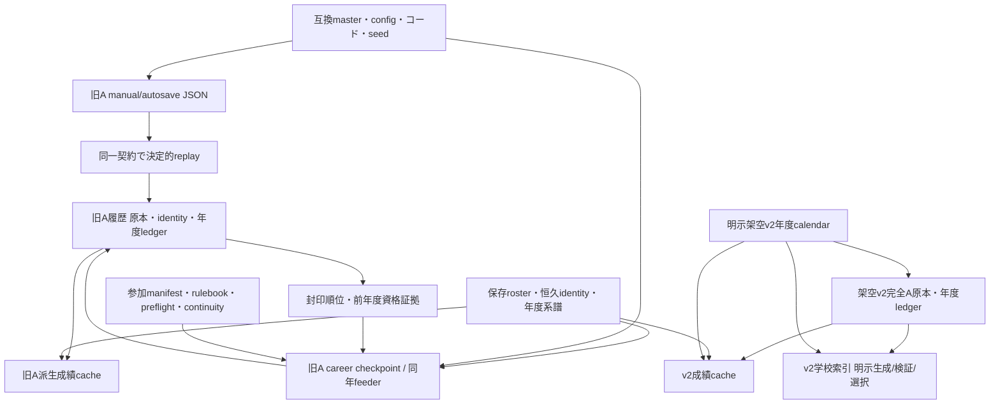

# Stage43G-91：正本inventory・依存関係・保存時系列・回復境界

2026-10-12（日本時間）。Issue #237。調査基点：mainのStage43G-90マージコミット `e74397bced489a12f6c4150b7ef75b8dffe199f5`。

**保存形式の正式採用はしない。** 本Stageはソースの呼出し追跡、自己生成fixtureと読み取り専用inventory、未採用の比較設計だけを追加する。製品writer/reader/schema、既存セーブ、master、GUIを変更しない。通常ロードに既にあるarchive再同期を監査APIから呼ばない。自動復元・移行・削除・GC・自動索引承認を追加しない。

## 1. 実行入口から追跡した三つの契約

| 契約 | 実行入口 → 保存/復元呼出し | 保存されるもの・接続範囲 |
|---|---|---|
| 旧A live | `live_game_cli.main/run_command` → `LiveGameService.new_game/play_today/next_day/advance_to/advance_through/save_game/load_game/finalize_season` → `SaveSlotManager.save/load` → `live_season_save`、`HistoricalMatchArchive.sync/seal_year` | 現行annual graphのISO日付、seed、plan、processed dates、完成試合結果、runtime照合値。loadはplanを再生成して試合をreplayし、archiveへ再同期する。全将来年度の自動ゲーム開始ではない |
| 旧A careerの明示ゲーム投影 | `CareerYearOperationService`、`CareerMultiPreviewCheckpointService`、single/regional/Kanagawa/placementサービス → 明示annual入力・保存rosterを使うAbilityMatchResolver → checkpoint JSON → 同じ旧A archive | 登録された翌年度の大会を実際に試合シミュレーションする。ISO日付・旧A保存、明示参加/前年度封印/同年feeder契約。関東17校E2Eはこの経路。公式の将来calendarや全年度自動進行ではない |
| 架空v2 sidecar | `career_calendar_v2`の明示plan → `CareerV2OptionAArchive.append/seal_year`、容量/長期fixture CLI → v2 reader/index | `G{year}:MM-DD`、架空policy、10000年以降も扱う完全A原本。live/career checkpoint writerはこのAPIを呼ばない。合成履歴の検証を実ゲームの年度進行と表示しない |

閲覧入口は `CareerHistorySlotSession` → 保存年度/学校catalog → history GUI bridge / history Tk pilot、またはcross-era GUI pilot → read gate/browse model。v2学校索引は学校gameページ/Tkから**独立した明示選択**で使う。読み取り専用閲覧はゲームの`load_game()`と別契約。GUI pilotの存在は正式GUI完成を意味しない。

`season_cli` / `cli` → `SeasonOrchestrator` / `TournamentEngine` → `results` / `season_results` / `BrowseRepository.replace_*` はCSV/JSONの計算出力・browse SQLiteを任意pathへ出す。slotのlive replay正本ではない。指定された外部入力や当時のsimulationが失われた場合に、計算出力を無条件に再生成可能とは扱わない。

## 2. slot単位の正本inventory

以下は**ソースに定義された名称**であり、利用者セーブのpath/学校ID/SHA一覧ではない。ファイルが存在することを全slotに要求する表ではなく、使う機能の必須集合を表す。

| 対象 | 分類 | authority・writer / reader、復旧依存 |
|---|---|---|
| `manual.json` / `autosave.json` | 進行中の正本checkpoint（独立した二系列） | `SaveSlotManager.save` → `write_live_season_save`。seed/resolver/plan fingerprint、ISO日付、processed dates、完成試合結果、history/status/activated、runtime/public snapshot fingerprintを保存。`restore_live_season_save`は同じmaster/engineでreplay照合。slot IDはpayloadに無い |
| `backups/{manual,autosave}.NNN.json` | 過去のcheckpoint候補 | 現行既定3世代のJSONだけをrotationする。historical SQLite/roster/各sidecarを含まない。save年数上限でも履歴GCでもない。`latest`は日付/processed件数を比較し同値ならautosave、mtimeやDB世代ではない |
| `historical_matches.sqlite3`内`historical_matches` | 永久保持する旧A試合正本 | `LiveGameService._sync_history`とcareer各`_sync`。完成試合の最終得点、各イニング、team/batter/pitcher成績をimmutable保存。全打席eventsはOption Aの必須対象外。旧score-only/欠落詳細を捏造しない |
| 同DB `archive_identity` / `career_years` | 正本の出典・年度登録/封印metadata | 初年度seed/resolver/plan identity、年度identity、active/sealed、件数、ledger。隣接次年度登録は前年度封印を要求。metadataだけ正しくても全原本が正しい証明にはならない |
| 同DB `historical_competition_outcomes` | 次年度資格判断の正本証拠 | `CareerCompetitionOutcomes.record_completed/previous_results`。封印ledgerとMAIN試合を照合した順位/ランキング。順位は当時のrun/入力の証拠と一緒に保持する。結果CSVや現行masterから推測し直さない。選抜委員会選考を意味しない |
| `career_rosters.sqlite3`の`career_school_rosters` | 学校年度の正本snapshot | `save_initial_roster` / `advance_and_save`。各年度の20選手、所属、氏名、entry year、grade、position/handedness、seed、cohort policyを保持。career bridgeの`roster_provider`は必須snapshotが無ければ拒否 |
| 同DB `career_player_identities` | 永続選手identity正本 | grade以外のidentityを保持・SHA照合し改変/再識別を拒否。ID/nameを現行masterや次年度seedで作り直して代用しない。初年度前年入学組も最初に保存した年度の証拠として保持 |
| `career_previews/{year}_{cid}.json` | 単大会旧A replay正本 | single checkpoint。slot/inputs、前年度ledger、plan/resolver、processed dates、完成試合件数/SHA。翌年度大会でありv2ではない |
| `career_multi_previews/{year}.json` | 複数大会旧A replay正本 | 明示annual inputs、initial draw digests、競技別進行、champions、同年late spring/Tokai concurrent状態。optimistic checksum guard。前年度封印、保存roster、同年予選/選抜の出典を必要とする |
| `career_regional_previews/{year}_{cid}.json` | regional途中進行正本 | multi upstream checksum/plan、feeder SHA、placement ID、Kanagawa sidecar選択、draw、seed、日付進行/試合SHA。上流JSONを新旧で混ぜない |
| `career_kanagawa_spring_previews/*` | 別保存された県大会途中正本 | 明示推薦/地区入力、roster、multi同年plan/履歴と照合。regionalへの供給依存を含む |
| `career_placement_previews/*_third.json` | 3位決定戦正本証拠 | Chiba/汎用placementサービス。元大会/同年multi runと固定participants/試合SHAを照合。MAIN試合だけでは供給順位が再構成できない場合がある |
| `career_invitational_manifests/*` | 明示参加選択の正本証拠 | `CareerInvitationalManifestService`。32校参加入力/annual plan/前年度封印を固定。daily checksumと同一ではない。**本Stageの世代manifest案とは別の既存参加manifest** |
| `career_year_rulebooks/*` | 年度ルール/host選択の正本証拠 | `CareerYearOperationService.register/read`。annual plan、前年度ledger、feeder構造、明示host仮定/未解決を保存。現行2026配分を無条件に翌年へ適用しない |
| `career_year_continuity/*` | 系譜・旧live参照選択の正本証拠 | `CareerYearContinuityService`。前年度封印/当年度identity、roster lineage、明示manual/autosave参照。2026参照はread-only referenceで2027の試合authorityへ統合しない |
| `career_tokai_preflights/*` | 事前凍結した選択/地区plan証拠 | `CareerTokaiConcurrentPreflight`。Senbatsu参加選択/愛知三重groupsと完了証明を拘束。単なるcacheではなく当時の明示入力・承認範囲を保持 |
| `sandbox_calendar_v2.sqlite3` | 架空v2 calendar正本 | `sandbox_year_plans`に年度ごと明示policy/MM-DDをSHAと保存。旧A ISOに流用・変換しない |
| `fictional_option_a_v2.sqlite3` | 架空v2完全A正本と封印metadata | `v2_option_a_matches` / `v2_game_years`。必ず同じcalendar SHA、日付token、年度ledgerを保持。同じv2 DBのappend/sealはStage89でBEGIN IMMEDIATE済み。複数DBの世代保証ではない |
| `derived_player_stats.sqlite3` | 破棄可能な旧A派生cache | sealed旧A試合＋roster/identityから明示build。active年度は原本へfallback。sealed source ledger/rosterとの照合が必要。欠落は正本復元/移行の理由にならない |
| `fictional_v2_player_stat_cache.sqlite3` | 破棄可能な架空v2派生cache | 封印v2＋calendar＋保存rosterの所属証拠から明示生成。旧A cacheと加算/混用しない |
| `fictional_v2_school_read_index[_version/_Gstart_Gend].sqlite3` | 任意の派生学校索引候補 | source/calendarの**絶対path**と年度ledger等をmetaに保持。新規移送先では通常foreign。元metaを書き換えて承認扱いしない。明示build→検証→候補選択を独立操作とする |
| 正本DB内のB-tree索引 | 再構築可能な検索構造だが同じ正本ファイルの一部 | 必須原本backupと一緒に保持。既存DBへDROP INDEX/VACUUMやschema migrationをしない。独立DBの学校索引とは別 |
| `slot_metadata.json` | 表示metadata | title/時刻/last source/seed/date。tmp replaceで別公開。欠落/遅れはゲーム結果や最新世代を証明しない。監査で復元しない |
| SQLite `-wal/-shm/-journal`、未公開`.tmp` | transaction/途中公開状態 | committed WALを落としてDBだけraw copyすることを避ける。稼働中集合を監査APIに渡さない。残骸の自動削除/checkpointは禁止 |

### 外部入力、属性・成長・所属、計算cache

`DataRepository.REQUIRED`の競技/stage/group/transition/access/seed/format/parameter、学校/野球部/地域membership CSVに加え、plannerは`season_calendar.csv`、stage calendar、`qualification_rules.csv`、`regional_feeder_rules.csv`、annual index等を解決する。future bridgeは明示参加校、groups、前年度outcome、地域/host仮定を使う。`paths.resolve_data_file`による現行master解決先はslot内に同梱されていない。

`config/abilities`のcatalog/scale/generation/intake/team JSONと`config/match`のsimulation設定、コードのresolver/planner version、名前providerも再実行の互換依存。liveのplan fingerprintは全config・コード・OSの実行互換性を一括証明するものではない。再起動/別PCではplan/resolver/seedに加えて結果・public snapshotのreplay照合が必要。バージョン化した外部入力保存・コード互換catalogは将来判断事項。

`PlayerRosterGenerator`は初年度属性/identityをseedから作る。`advance_school_roster`は保存前年度から進級/卒業/新入生を作り、既存選手identityを保持する。`AbilityMatchResolver.team_input`の能力とteam strengthはroster/seed/year/configから計算し、`_team_cache/_roster_cache`はメモリ派生。恒久的な任意の練習/負傷/移籍/経験値writerはこの呼出し系に無く、それらの状態が保存済みと主張しない。「成長」を別ファイルのmutable能力正本と誤認しない。将来導入時は正本集合の追加審査が必要。

`BrowseRepository`のseason/run/match/stat/event/player master tables、CSV結果/summary、player/ability/team出力CSVはbrowse/export系。元run・入力が保持される範囲だけ再構築可能。任意pathに利用者が唯一の結果を保存している場合は外部正本候補として申告が必要で、inventoryは未知fileを自動で派生扱いしない。slot外の任意pathを自動探索しない。

## 3. 依存関係図

live/careerからv2 appendへの辺は存在しない。旧A/v2のcross-era閲覧は出典別の閲覧であり、連続ゲーム世代の接続証明ではない。

## 4. 保存時系列と機能ごとの同一集合

旧A live：メモリ進行 → JSON旧backup rotation → JSON tmp replace → slot metadata tmp replace → archive.sync transaction。長いadvanceは完成試合日にautosave checkpointを作る（Stage43C2）。`autosave=False`の未保存分はcheckpointに無い。load：JSON検証 → masterからplan再生成 → processed datesをreplay →結果/runtime/public照合 → archiveへ再同期。古いJSONロードはarchiveの新しい試合を削除しない。

年末：readiness → manual JSON/metadata → archive sync → seal（件数/ledger）→必要なcompleted outcome保存。`finalize_season`は次年度ゲームを開始しない。career next-year：前年度封印 → 保存roster進級/明示annual plan → register_next_year → checkpoint → sync。multi/regional等は上流checksum/選択証拠を先に照合する。JSONとDB群全体のtransactionは無い。

v2：明示calendar commit → append commit → seal commit → 任意索引生成/検証/明示選択。全体一括generation公開は無い。Stage90のlab manifestはこの製品時系列へ接続されていない。

| 機能 | 必ず整合するもの | 失敗・回復の境界 |
|---|---|---|
| 年度途中manual/autosave | 選択JSONのseed/resolver/planと互換外部入力、完成試合、当年archive identity/既存一致行 | JSON先行の当年不足行は既存明示ロードの再同期候補。監査は修復しない。archiveが先行する古いJSONは履歴巻戻しではない |
| 封印後の得点/イニング閲覧 | 原本payload SHA＋年度ledger/封印identity | 原本/封印ledger不足・不一致は拒否。最新masterだけ更新しても過去得点を変えない。score-onlyを完全Aへ補完しない |
| 選手/学校年度成績 | 上記＋該当年度roster/identityと所属照合 | 派生cacheが無くても原本読取/明示再生成候補。roster不足を新seedで補填しない |
| 年度またぎ/予選→地域大会 | 前年度封印/outcomes、保存roster系譜、checkpoint、上流同年進行・feeder/placement、rulebook/参加選択 | 登録/封印/上流証拠不足は停止。2026 JSONを翌年checkpoint authorityへ統合しない |
| 再起動/別PC save移送 | 全保持履歴、上記の選択した途中checkpoint/証拠、外部入力互換 | JSONだけの移送は過去年・roster・資格・選択を保護しない。byte SHAだけでslot/署名を証明しない。絶対path索引は不使用→明示再生成 |
| read-only GUI | 明示選択した原本年度、ledger、calendar、roster | 通常ゲームload禁止。索引が無い場合に自動build/承認しない。activeをsealed historyとして表示しない |
| 途中保存のbackup/復元 | 単一JSONの復元と全slot集合の復元を区別 | JSON rolling backupから全SQLiteの同一世代を推定できない。archive先行/年末封印/別PC不足は手動判断 |
| 架空v2閲覧 | v2原本＋同じcalendar SHA＋封印ledger（選手表示ならrosterも） | 旧A ISOとtokenを混ぜない。calendarだけ先行する年度も完全世代とは認めない |
| 索引の明示選択 | 新しい出典path/元ledgerと独立候補の完全検証 | 移送した旧索引のmetaを書換えない。索引欠落は正本欠落と分ける |

永久保持対象は**保存されたすべての旧A/v2試合・封印ledger・roster/identity・明示選択/年度資格証拠**。最新yearだけが一致しても過去年の完全性を保証しない。更新可能な外部master/configは将来の計算に使えるが、過去replayの互換性を検証せず置き換えない。

## 5. 独立read-only inventoryの保証範囲

`inventory_slot(... authorized_read=False)`は既定で読取前に拒否。ユーザーが特定入力の読取を明示許可した呼出しだけtrueにする。本Stageの実行は全てTemporaryDirectoryの自己生成fixture。既存saveは非公開SHA不変確認だけで、inventory入力にしない。CLIは製品save pathを受け取らず20 fixture回帰だけを実行する。

APIは `legacy_live`（manual/autosaveを明示）、`legacy_history`、`legacy_player_history`（roster component追加）、`fictional_v2`の契約を別々に検証する。既存保存構造をraw readし、JSON checksum/schema、当年plan/seed/resolver、旧A行/payload SHA/封印ledger、v2 calendar/token/ledger、roster/identity componentを照合する。実ゲームreplayの試験はAPIの外で既存serviceを自己生成fixtureへ使う。APIの`contract_consistent`は**選択したcomponent契約の整合**であり、replay・全選手所属・成長・資格/feeder・全saveの復元可否の証明ではない。

任意SQLiteを派生と推定しない。既存v2学校索引namespaceと二種のstats cacheだけ不使用の派生と分類。checkpoint/年度選択証拠はchecksum/slotだけ照合し、完全依存/replayを未検証と報告。未知fileは件数と要手動確認だけを返す。結果/例外には入力path・学校/選手ID・SHA値・タイトル・rawエラーを返さない。

symlink/junction（祖先も含む）、root名とslot不一致、WAL/SHM/journalは読取前に拒否。Windowsの正当な8.3短縮pathはresolveで正規化する。閉じたcopyに`mode=ro&immutable=1`とquery_onlyを使い、SQLite sidecar生成を避ける。未checkpoint WALをimmutableで見落とさないよう、先に全sidecarを拒否する。稼働中DBのbackupをこのAPI内で行わない。前後SHAとfile集合が変化したら拒否し、読取接続はcloseする。fixture writerの既存`_connect`にはtest内だけでcloseするcontextを与え、GC待ちでWindows handleを残さない。製品接続APIは変更しない。これは共通lock/電源断/ABAに対する原子snapshot保証ではない。

private `expected_files`は独立にpinした集合とのメモリ上照合。必須正本欠落/別内容を拒否、派生だけの欠落は不使用/明示再生成候補。署名/永続approval/manifestではない。legacy live JSONもv2もslot identityを保存しないため、同じseed/plan/bytesの別slotや整合的に切り落とされた過去年は内容だけでは識別不能。anchor無しは必ず未証明の注記を返し、全結果で`restoration_authorized=false` / `whole_game_restore_proven=false` / `generation_adopted=false`。APIの緑判定で復元/移行を自動実行しない。

## 6. リスク順位と別PRの最小修正候補

| 優先度 | 現行リスク / 最小fixture根拠 | このStageの対処 / 別PR候補 |
|---|---|---|
| P1 | **旧A sync/seal競合**：syncがactiveをSELECTした後、別接続sealが1件で封印。syncが2件目をinsertし、sealed件数1/実件数2となる。`test_stage43g91_legacy_boundaries`はEventで順序固定、sleep無し、実SQLite二接続 | inventoryはledger不一致を拒否。元の1試合も2試合目も上書き/削除しない。別PRで旧A sync/sealのstatus/ledgerチェックからcommitまでのwriter予約（Stage89のv2と同様の評価）、register/outcomesとの範囲を検討。共通slot lock/新保存形式とは分離 |
| P1 | JSON保存成功後sync失敗、古いcheckpoint復帰、年度封印と手動途中saveの組合せ | JSON先行/DB先行を区別して情報だけ返す。fixtureで既存replay再同期とhistory非削除を確認。全slot復元や封印済み過去の再生成を認めない |
| P1 | JSON-only backup/別PC移送でroster・過去年・明示参加/feeder・互換configが抜ける | 必須集合inventoryとprivate pin。不足を拒否。将来copy inventory/互換catalogが必要 |
| P2 | 並行JSON writer：固定`.tmp`やbackup rotation、checksumのcheck→replaceが同時保存全体を予約しない。archive.sync/年末/outcomesも全slot公開transactionを持たない | このStageでは未修正。別PRで独立tmp/no-clobber/参加者を全網羅する設計と確定的並行試験。Tkの単一UI操作だけで全CLI/process協調を保証しない |
| P2 | 索引の絶対path束縛、異slot/calendar混在、整合的な過去削除、master変更 | 派生不使用、calendar/seed/ledger/pin拒否を試験。永続信頼元・署名は未採用 |
| P2 | OS停止/電源断、Windows handle/antivirus、Linux directory fsync、disk full・NFS・耐久性 | Stage90 process killと同一視しない。正式導入前に対象OS/FSで別受入試験 |

再現試験の「sealed1/実2」は既存不具合を観測する監査assertionであり、製品の受入条件ではない。別PRで修正したら「writer先行なら封印件数が一致、sealer先行なら新行拒否」へ試験を変更する。今回新規修復を混ぜない。

## 7. 方式比較・正式判断

[ADR-032](../adr/ADR-032-production-save-inventory-adoption-proposal.md)のA/B/C選択表に、容量式、Stage90実測範囲、OS制約、ATTACHの適用限界、段階案とrollback条件をまとめる。[ADR-030](../adr/ADR-030-v2-multifile-generation-snapshot-proposal.md)/[ADR-031](../adr/ADR-031-generation-backup-recovery-evaluation.md)は引き続きProposed。本Stageで新しい正式方式を採用しない。

専用CIは両OSで新規20監査（実旧A replay/境界を含む）とStage90回帰、LinuxでStage89と既存旧A save/year関連回帰を追加する。既存全suiteはUbuntu、関東17校は独立ジョブ。fixtureのJSON読書はUTF-8を指定する。

Stage89の元workflowはLinux限定。追加確認したWindowsでは8.3 pathとfixture probeの一致、開いたfileへのrename/fixture legacy handle終了がLinuxと同じではなく、その全schedule成功を保証しない。Stage91は本番v2 readerを変更せず、元Stage89のOS検証範囲を維持する。Windowsの安全な公開/reader pin/rename耐久性はADR-032の正式導入前受入事項として残す。
