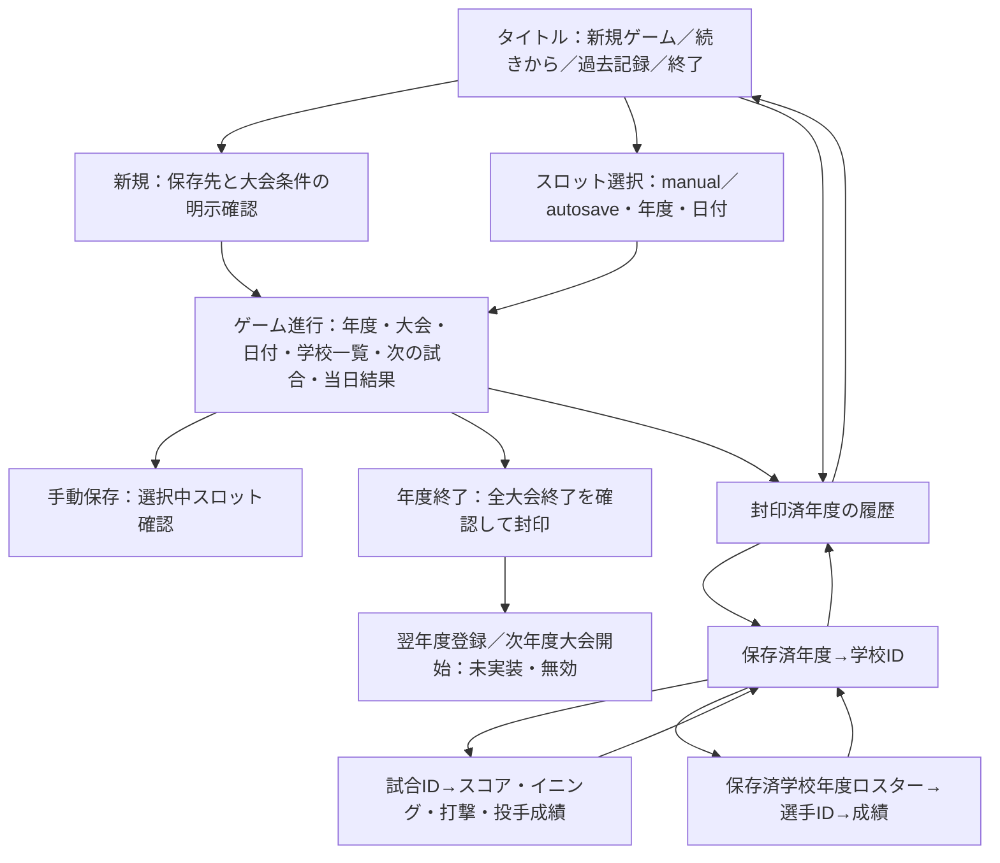
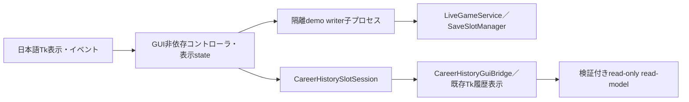

# Stage43G-98 正式WindowsゲームGUI v1・最小操作パイロット設計

対象はWindows専用・個人利用・非配布の高校野球ゲーム。全国の試合、Option A（スコア、イニング、個人成績）、学校・選手の歴史を眺めることが目的。年度に人為的な上限を追加しない。2026年・8校の制限はこの試験だけ。EXE、インストーラー、署名、自動更新、クラウド運用は対象外。

## 正式画面構成と導線

|画面・操作|主要情報と契約|ロード・失敗・確認・未対応|
|---|---|---|
|タイトル|新規・続きから・過去記録・終了。起動だけではsaveを書かない|新規は確認必須。既存スロットの新規上書き拒否|
|スロット|ユーザーが保存先とmanual/autosaveを選ぶ。latestへ暗黙切替しない|未知ID・外部パス・リンク・破損は拒否。失敗時は元画面維持|
|進行|サービス返却の年度、大会、日付、学校ID、当日結果と次の対戦|処理中は全操作無効。二重イベント拒否。失敗時保存世代を維持|
|保存|選択中demoへの手動保存を明示。進行後のautosaveを表示|確認ダイアログ。保存失敗の理由を日本語表示|
|年度終了|全試合完了のreadiness確認→履歴封印|確認必須。翌年度実試合は開始しない|
|履歴|封印済年度だけ。ID・年度・出典を保持して学校→試合／選手。戻るスタック|未封印・破損は拒否。履歴からload_gameを呼ばない|
|終了|UI・履歴子窓を閉じる。保存は独立した明示操作|終了確認。保存済demoの再起動手順を表示|
|将来バックアップ|停止済み方式A exportを別画面で設計する|この試作では無効。restore/import/activationの操作なし|

## サービス境界と拡張

|接続|ID・値の出典|読書き・所有契約|
|---|---|---|
|新規・進行・保存・続き|LiveSeasonGraphPlannerの2026年度CMP000029を8校に限定。seed 2026101201、AbilityMatchResolverを新規／再生で同じ設定にする|LiveGameService・SaveSlotManagerはwriter。load_gameもarchive syncを書き得る|
|暫定ロスター・大会結果|resolverが実生成した_roster_cache、runtime.completed_runs|試験workerだけでCareerRosterArchive／CareerCompetitionOutcomesへ明示保存。本番統合を意味しない|
|年度→学校|CareerHistorySlotSessionが選んだdemoの封印済年度、保存済学校ID・ロスター名|履歴ではwriter未使用。年度候補は未検証表示、選択後に出典を再検証|
|試合→選手|bridgeが返すselected_year・school_id・match_id・player_id・sourceを含むtarget|表示名をキーにせずtargetを渡す。原本SHA・ロスター所属を再検証|

Tkはゲーム判定を持たない。コントローラは表示stateとイベント受付を持ち、workerがゲームAPIを呼ぶ。将来はworker adapterを全国／複数大会サービスに置き換え、大会一覧の行を増やす。日付・対戦・終了可否は既存runtime APIから得る。公式UI移行時には選手能力の閲覧表、日本語成績表、フィルタと大量記録ページングを段階導入する。

## 隔離・失敗時の契約

新規起動は専用一時領域にUUIDで排他的なdemo workspaceを作り、開始ボタンまでゲームを作らない。再起動は表示されたdemo IDのみ指定する。任意save_root／slot／import引数は提供しない。固定demo slot以外拒否。manifestの型・固定実験条件・世代・全ファイル集合とbytesを検証し、リンクや未知ファイルを拒否する。これは事故防止の実験所有確認であり、敵対者が作ったreceiptを認証する仕組みではない。

各writer操作は検証済demoを新しい作業世代へコピーし、子プロセスで完了してからmanifestを原子的に切り替える。失敗した子処理は選択中保存を書き換えない。旧世代は保持。既存ユーザーsaveの自動探索／入力／上書き、本番restore、履歴削除を行わない。古いmanualの結果が現在のarchiveと合わない場合は続きからを拒否し、別sourceの明示選択を求める。二重ボタンはbusyで拒否、同じdemoの多重起動は排他的lockで拒否。異常終了で残ったlockの自動除去はしない。

## SQLite寿命・旧backup互換の課題表

|製品箇所|現状の所有境界／課題|Stage98対応と別Stageの検証案|
|---|---|---|
|HistoricalMatchArchive・LiveGameService|短期connectをwithで利用。Connection.__exit__はcloseではない|writer子プロセス終了で試験handles解放。製品は明示close/context manager導入後、正常・例外・封印・ロードでWindows rename確認|
|CareerRosterArchive|保存・一覧・年度ロスターreadが接続を作る。GC依存箇所あり|試験worker専用暫定保存。製品closeは別Stage。ロスター保存例外・年度検索後renameと未変化bytes検証|
|CareerCompetitionOutcomes|match archiveのconnectを使用。結果保存の本番facade接続は未統合|試験workerが封印後明示保存。所有者をfacadeへ統合する際に接続寿命も確認|
|履歴read-model群|read-onlyでもwith終了だけではnative handleが残り得る|試験Tkイベントの範囲だけhandleを捕捉しfinallyでclose。製品APIには変更なし。戻る・破損・子窓終了後rename試験|
|SaveSlotManager|JSONとarchiveの二段保存。load時同期あり|試験世代コピーで選択中原本を保護。製品トランザクションと失敗復旧は別Stage|
|Stage94互換catalog|固定338ファイルをhash。製品ソースclose変更だけでも旧候補verifyが壊れ得る|catalog対象製品ファイルを変更しない。旧候補verify回帰を維持。別Stageでcatalog版IDと旧版allowlist・fixture golden候補を設計し、変更前export→変更後verifyをWindows/Linuxで試験|

方式A停止済みexport、Stage95–96のfixture限定検証は維持。製品restore/import・migration、B/C世代管理は対象外。この試作の世代はdemo操作失敗を隔離する内部作業領域であり、製品backup世代機能ではない。

## Windows起動と試験

Python 3.12と標準TkがあるWindowsでリポジトリ直下から `py -3.12 -m phase2_engine.live_game_tk_pilot`。タイトルで「新規ゲーム」を確認し「次の試合日まで進む」、必要なら「翌日へ／当日の試合」、手動保存、全7試合後の封印を操作する。画面に示す `py -3.12 -m phase2_engine.live_game_tk_pilot --demo-id <ID>` でGUI終了後に再起動し、manualかautosaveを明示して「続きから」、またはwriterロードをせず「過去記録閲覧」を選ぶ。一時領域のためOS清掃で失われ得る。個人の本番保存先には使わない。

Windows native mapped Tk必須CIとheadlessコントローラ試験を分離。実ウィジェットinvoke、日付・試合進行、保存、UI破棄／再構築、明示ロード、年度→学校→スコア／イニング／個人成績→選手、破損拒否と終了後renameを検証する。全unittest、関東17校E2E、Stage94–97回帰は既存CIを維持。Linuxは開発補助。マスターCSVの集合とbytesは私的検証し公開artifactにhashや内部パスを出さない。Windows実機で人が遊んだ検証ではない。
