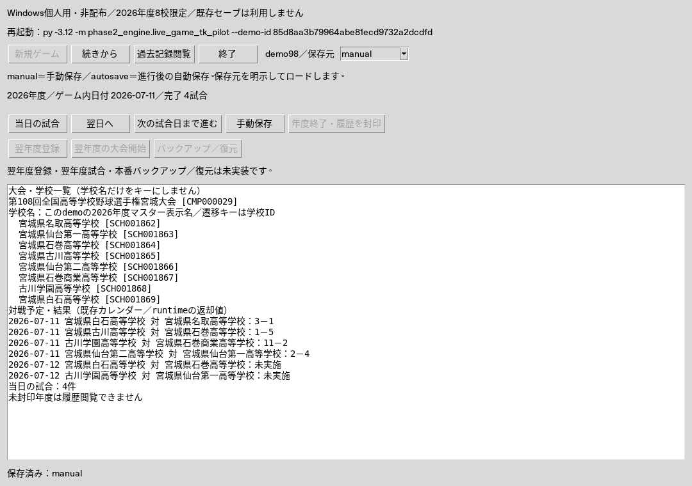

# Stage43G-98 最小Tk操作パイロット実施報告

PR #250のマージ後main（861c27e）から専用ブランチ `stage43g98-windows-tk-game-pilot` を作成。Issue #251の正式GUI導線初版と、自己生成8校単大会を操作する日本語Tk試作を追加した。全国／複数大会ゲームの正式GUI完成は宣言しない。

## 実装結果

- [正式GUI v1設計書](stage43g98_windows_gui_design_20261014.md)：画面遷移図、確認・失敗・未対応状態、writerと履歴read-only境界、SQLite寿命と338ファイル互換課題、Windows起動手順。
- `live_game_tk_pilot`：日本語タイトル、新規、manual/autosave選択、続き、日付／試合進行、当日結果、学校／大会一覧、手動保存、年度封印、履歴、終了。翌年度登録／実試合とバックアップ／復元は無効＋説明。
- `live_game_demo_controller`：表示state・操作受付・明示slot/source検証・排他的demo lock・作業世代と原子的選択・writer子プロセス管理。Tkからは非同期begin/poll、headlessからは同期execute。同じ操作契約を再利用し、PythonのバックグラウンドスレッドにTkオブジェクトを破棄させない。
- `live_game_demo_worker`：既存LiveGameService／SaveSlotManager／カレンダー・大会プラン・能力resolverを再利用。2026年度、seed 2026101201、宮城夏CMP000029を8校に限定。新規とロードで同じ能力設定・resolver契約を使用。
- 履歴はCareerHistorySlotSessionと既存CareerHistoryTkPilot／bridgeを再利用。封印済年度→保存済学校→試合スコア／イニング／打撃／投手成績→保存済選手を閲覧。履歴入口はload_gameを呼ばず、戻る先もID・年度出典を維持する。

能力モデルのロスターはresolverの実生成cache、大会結果はruntime.completed_runsを封印後に試験workerが明示保存する暫定対応。本番facadeへの自動統合は未実装。writerのSQLite寿命は子プロセス終了、履歴readの寿命は試験イベント範囲のfinally closeで管理し、製品ソースのclose契約を変更していない。

## 検証結果と受入方法

|検証|結果／実行方法|
|---|---|
|コントローラ・失敗・cleanup|Linux Python3.12で6件成功、skip 0。新規→日付→7試合→manual/autosave→封印→終了→明示再ロード。未封印・未知slot/source・既存demo新規上書き・古いmanual・破損・二重／多重起動・子処理失敗／timeout・公開失敗を拒否|
|実Tk操作|Linux補助mapped Tkで1件成功、skip 0。実ボタンとTreeview選択、UI終了／再構築、manual/autosave再ロード、学校・試合・イニング／個人成績・選手、破損拒否、閉じた後のrename|
|関東17校E2E|ローカル2件成功（291.217秒）。既存CIの専用ジョブも維持|
|全Python unittest|既存の全suiteジョブを維持。関東E2Eは専用ジョブで別実行。最終PRの全チェック成功を受入条件とし、CI結果はPR検証欄に記録|
|Windows主要CI|Python3.12 headlessとnative mapped Tkを別必須ジョブに追加。zero skips／件数確認付き公開JSON。Windows全suite二重常時実行は追加しない|
|Stage94–97回帰|既存workflow／全suiteを弱めず維持。旧338互換カタログverify成功。カタログ対象製品ファイルは変更0|
|マスター|data全ファイル集合・bytesの独立pinで不変。内部hash／パス一覧は公開artifactに含めない|
|既存セーブ|候補0件。未検証。存在する場合も試験入力には使わない。自動接続／上書き／本番restore／履歴削除なし|

WindowsのCIは表示済native Tkの自動イベント操作であり、人によるWindows PC実操作・目視評価ではない。ゲームworkerは操作ごとの別プロセス、UI再起動はTk root破棄／再構築と新しいコントローラから明示再開を検証する。試作起動コマンドのdemo IDでプロセス終了後も専用一時領域を明示再開できる。OS一時領域清掃、異常終了lockの残留は実験の制約であり、本番saveとして使わない。

実Tk試験で発見した破損時の完了監視漏れとTkオブジェクトの別スレッド破棄は、writer子プロセスのbegin/pollに統一して解消した。子プロセスstdoutは作業領域のファイルで受け、詳細成績がpipe容量を超えてもGUIが待ち続けない。timeout／終了はchildを停止・waitしてから作業領域を閉じる。

## 実表示

以下はLinux補助環境（Python3.13／Tk8.6／Xvfb）での試験画面。Windowsの実表示を撮影したものではない。日本語ラベルと4試合終了時の表示を確認する参考画像。

## 残課題・次Stage候補

|優先度|次Stage|完了判断のための試験|
|---|---|---|
|P1|本番LiveGameServiceにロスター・大会結果保存を統合|通常進行、再生、封印、例外復旧が冪等。保存ID・年度・能力resolver出典が一致。全国／複数大会の本番計画へ接続|
|P1|製品SQLite接続寿命と旧backup互換保証|明示close所有境界とcatalog版管理を同時設計。変更前の旧export候補を変更後にverifyできること。Windows正常／例外終了後rename、全Stage94–97回帰|
|P2|正式GUIの段階導入|この導線仕様を本番サービスへ接続。学校・選手・試合の日本語表表示、年度／大会／ページング、実Windows個人PC操作を確認|

年度登録のみを翌年度実試合の開始と扱わない。全国career長期運用、正式GUI完成、製品restore/import／自動migration、B/Cバックアップ管理、配布対応は未実施。全CI成功後もPRをマージせず、auto-mergeなしでレビュー待ちとする。
